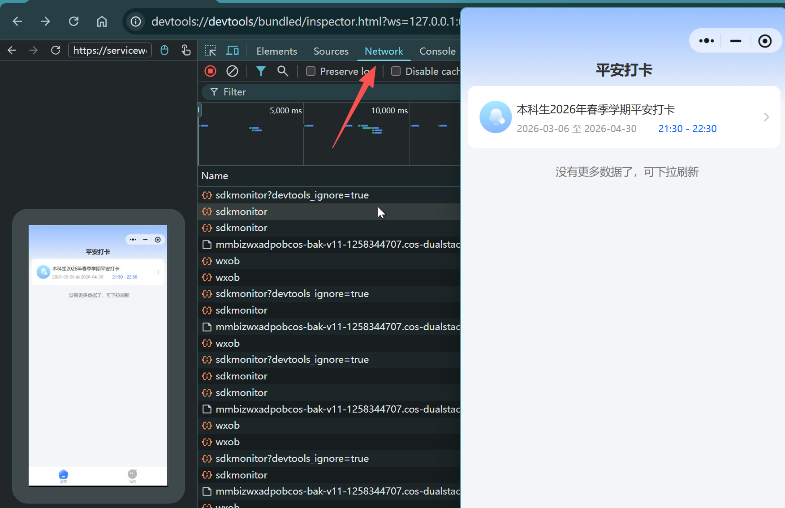
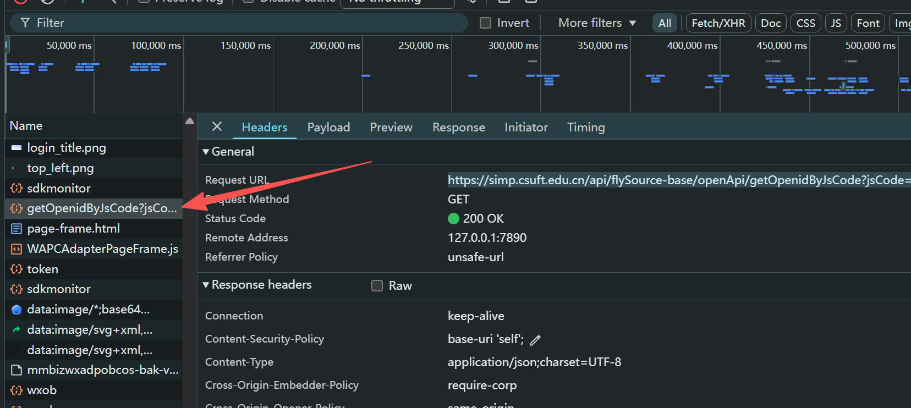
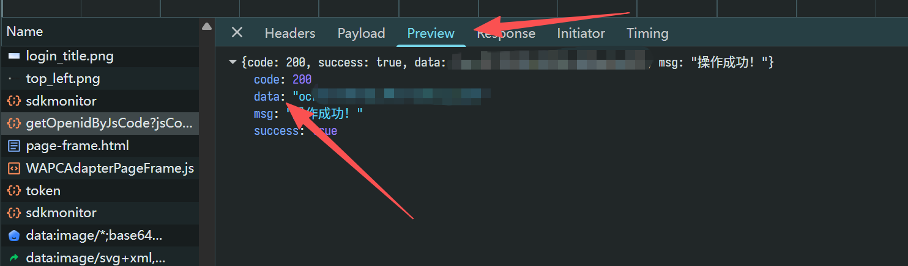

# 获取 OpenID for csuft-unsafe-dorm

以下内容仅供学习和研究使用，请勿用于任何非法用途。

由于配置不允许直接使用账号密码登录，因此需要使用 OpenId 来进行鉴权。由于你专仅允许了 wxapp 的 OpenId 作为唯一的 OAuth 鉴权方式，所以请确保你已经在小程序中登录并绑定过。

该 OpenId 理论长期优先，所以以下操作大概率只需要操作首次进行抓取即可。

## 使用 mitmproxy 自动抓取

仓库自带独立的抓包工具 `tools/openid-capture`。它会启动本地 mitmproxy、临时切换系统代理，抓到 OpenID 后打印到标准输出并恢复原代理。

环境要求：

- Node.js 20 或更高版本。
- Windows 或 macOS；Linux 需要 GNOME 桌面会话才能自动切换系统代理。
- Python 3.12 或更高版本。首次运行时工具会把 mitmproxy 安装到 `tools/openid-capture/.cache/venv`。
- 电脑版微信，以及微信中的“中南林业科技大学学生工作部”小程序。

运行：

```bash
yarn capture:openid
```

看到“系统代理已切换”的提示后，在微信中打开小程序，退出登录再重新登录一次。标准输出只有一行 OpenID，把它填入 `.env`：

```env
openid=抓到的OpenID
```

参数、日志位置和 Linux 证书导入方式见 [`tools/openid-capture/README.md`](../tools/openid-capture/README.md)。

## 配置 WMPFDebugger（备用方案）

mitmproxy 不可用时，可以使用 WMPFDebugger 手动 Hook 小程序。

1. 下载并允许 WMPFDebugger：

    - clone [evi0s/WMPFDebugger GitHub 仓库](https://github.com/evi0s/WMPFDebugger)。值得注意的是，截至目前最新版的 Windows 微信客户端的 WMPF 版本是 19027。官方的仓库可能暂时没有对该版本进行支持。你可以选择 [186526/WMPFDebugger](https://github.com/186526/WMPFDebugger)，我已经在该仓库中合并了对 WMPF 19027 版本的支持。

    - 安装依赖

    ```bash
    cd WMPFDebugger
    yarn
    ```

    - 启动 Hook 服务

    ```cmd
    > npx ts-node src/index.ts
    [server] debug server running on ws://localhost:9421
    [server] proxy server running on ws://localhost:62000
    [frida] script loaded, WMPF version: 18955, pid: 61740
    ```

2. 开始 Hook 微信

    - 打开微信，进入小程序，找到 "中南林业科技大学学生工作部" 打开。

    - 此时同时打开 DevTools (`devtools://devtools/bundled/inspector.html?ws=127.0.0.1:62000`)

    - 在 DevTools 中，切换到 Network 标签页备用。

    

    - 切换回小程序页面，点击 "我的" 页面，若已登录请先退出。

    - 在 "我的" 页面中，点击 "点击登录"，登录至该小程序。

    - 此时在 DevTools 的 Network 标签页中，你应该能看到一个新的请求，URL 以 `getOpenidByJsCode` 开头。
      其 Detail URL 为 `https://simp.csuft.edu.cn/api/flySource-base/openApi/getOpenidByJsCode?jsCode=xxx`。

    

    - 接下来我们切换到 Preview 标签页，在 Response 中你应该能看到一个 JSON 对象，其中包含了 `data` 字段。
      该字段的值即为你的 OpenId。

    
